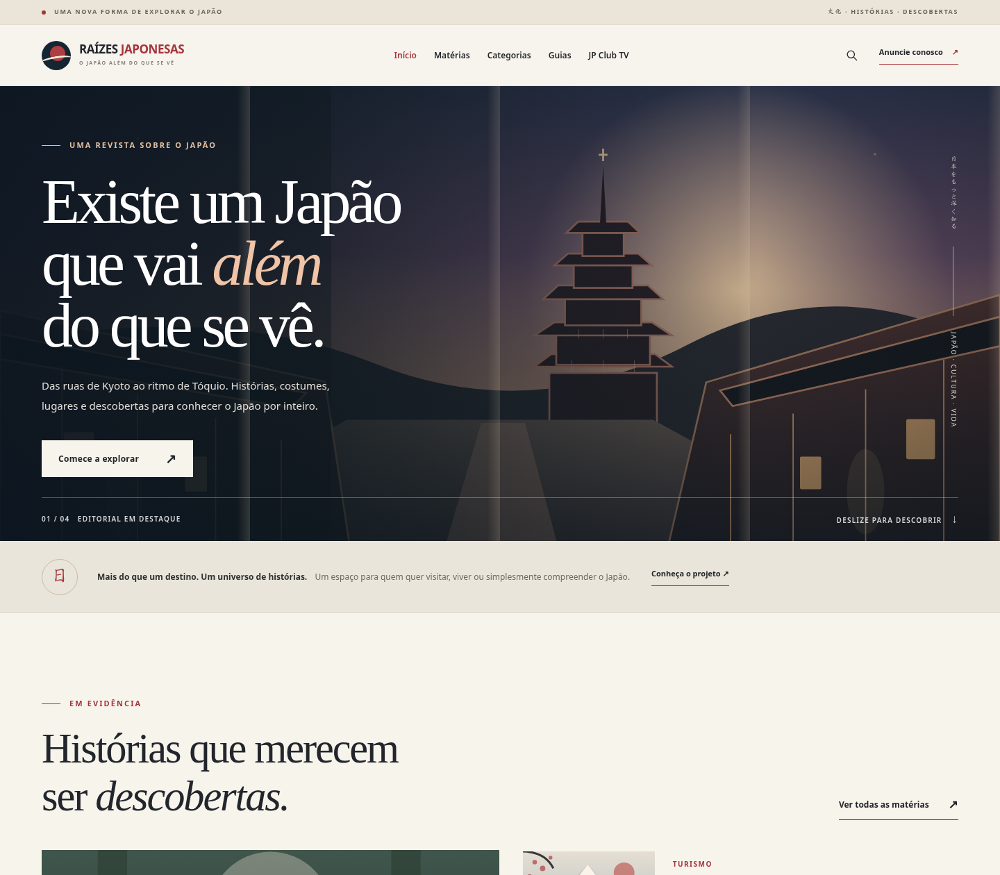

# Ronaldo Yamada · Desenvolvedor Full Stack

Desenvolvo sites responsivos, sistemas web e automações na **YA SOLUTION**. Trabalho com **TypeScript, JavaScript, Next.js, Supabase e PostgreSQL**, da interface ao banco de dados.

[Conheça a YA SOLUTION](https://yasolution.com.br)

## Projetos selecionados

### Secretaria de Membros · Sistema full stack

Desenvolvi uma aplicação para centralizar cadastros e rotinas de atendimento em uma secretaria. O trabalho inclui autenticação, cadastro de membros, painel administrativo e agenda.

**Decisão técnica.** Separei o fluxo de login e as permissões de acesso das operações de cadastro. Um fluxo representativo é entrar no painel, cadastrar um membro e consultar o registro.

### Oli Idiomas · Site para escola de idiomas

Desenvolvi a interface responsiva e organizei a apresentação da escola e das aulas. A página aproxima a apresentação dos cursos do caminho de contato para quem quer saber mais.

### Raízes Japonesas · Blog editorial

Desenvolvi a identidade visual e o layout responsivo de um blog sobre cultura japonesa. Organizei o conteúdo para facilitar a descoberta de publicações e manter a leitura confortável no celular.

[Ver a prévia no celular](./preview-mobile.png)
